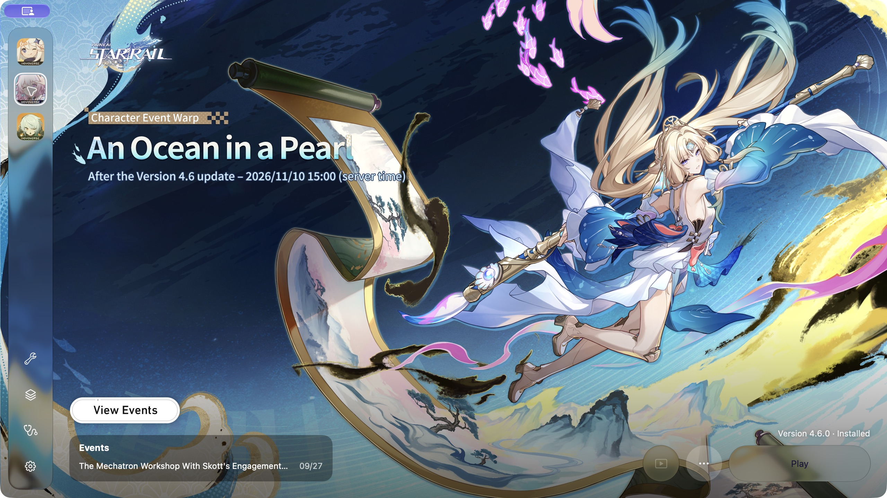
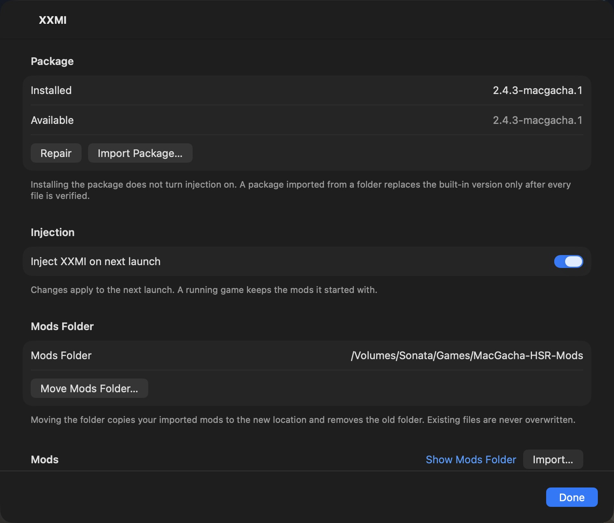
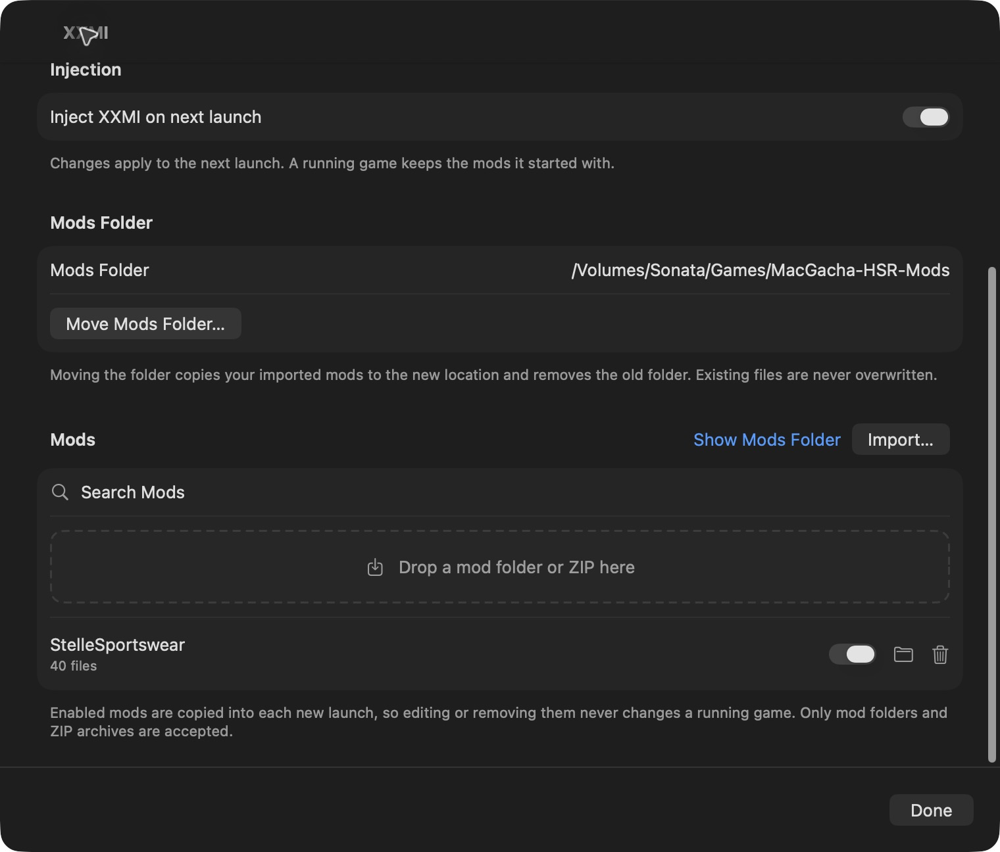

# MacGacha XXMI — Star Rail and ZZZ mods on Apple Silicon

> 🧪 **XXMI fork of [MacGacha](https://github.com/deruta74/MacGacha).** This fork adds 3DMigoto/XXMI mod support for **Honkai: Star Rail** and **Zenless Zone Zero** on top of upstream MacGacha 0.3.2. Fork builds are published separately: see [fork releases](https://github.com/notsonata/MacGacha-xxmi/releases/latest).

MacGacha is a native macOS launcher for HoYoverse games on Apple Silicon. It installs, updates and verifies games from HoYoverse's official servers, manages the Wine, DXMT and D3DMetal runtimes, and starts each game with one click. This fork builds on that to load character and UI mods into the game. You don't need XXMI Launcher or a Windows machine.

| Game | Mods | Status |
|---|---|---|
| **Honkai: Star Rail** (Global) | SRMI | ✅ Supported |
| **Zenless Zone Zero** (Global) | ZZMI | 🧪 Experimental, working |
| Genshin Impact | — | ⛔ Not planned. The game itself still launches from MacGacha, but this fork won't add GIMI. |

- Requirements: an Apple Silicon Mac running macOS 27 or later, with Rosetta 2 (MacGacha offers to install it).
- Mods need the **D3DMetal · Wine 11.20 / GPTK 4.0b3** runtime. Other runtimes can still play the game, but without mods.

Code and documentation in this repository may be written or modified with assistance from large language models (LLMs) and AI agents. The software is provided under the [GPL-3.0 license](LICENSE), as is, without warranty.

## Releases

| Download | What it is |
|---|---|
| [**MacGacha app (latest)**](https://github.com/notsonata/MacGacha-xxmi/releases/latest) | The app DMG, with both XXMI packages built in. Start here. |
| [**Star Rail package (HSR / SRMI)**](https://github.com/notsonata/MacGacha-xxmi/releases?q=xxmi-hsr&expanded=true) | Standalone `XXMI-HSR-<version>.zip`. Use it when a package update ships without a new app. |
| [**ZZZ package (ZZMI)**](https://github.com/notsonata/MacGacha-xxmi/releases?q=xxmi-zzz&expanded=true) | Standalone `XXMI-ZZZ-<version>.zip`. Use it when a package update ships without a new app. |

The package links list that game's package releases, newest first. To install one, extract the ZIP and choose its folder in **XXMI → Import Package…** for that game. A package that needs a newer app says so, so update MacGacha first in that case.

## Getting started with mods

1. Install or locate the game in MacGacha, then in its settings select the `d3dmetal-wine11.20-gptk4.0b3` runtime.
2. Open the **wrench** (XXMI) in the sidebar and click **Install**. The mod package is bundled with the app, so this works offline.
3. Import a mod folder or ZIP, or drag it into the mod list. Enable the mods you want.
4. Turn on **Mods** above **Play**, acknowledge the ban-risk warning the first time, and launch.

Mod injection is off by default. Read [Is it safe?](#is-it-safe) before you enable it.

### Honkai: Star Rail

- SRMI loads through the standalone XXMI injector core and a small launch runner, before the game starts.
- Mods built for Windows SRMI work unchanged.
- SRMI's saved settings (`d3dx_user.ini`) carry over between launches once the game closes normally.

### Zenless Zone Zero (experimental)

- **Turn DirectX 12 off** in ZZZ's game settings in MacGacha. Mods need Direct3D 11, and MacGacha refuses to inject into DX12 rather than changing your settings.
- ZZZ's anti-tamper module crashes the game when a module is injected the usual way. This fork instead places ZZMI as the prefix's `d3d11.dll` for the length of one session. It records every file it changes and puts the originals back when the game exits, or on the next start if MacGacha or the game crashed.
- **In-game graphics:** keep **Character Quality** on High and set **High-Precision Character Resolution** to **Off**. If a modded character still looks unmodded, or turns into spiky shards, check this setting first. Our frame captures show that some characters are then drawn through a GPU path that mods can't hook.
- ZZZ has its own mod library (`MacGacha-ZZZ-Mods`), its own ZZMI package and its own saved settings, separate from Star Rail.

### Managing mods

- **Enable or disable mods individually**, search and sort your library, reveal folders in Finder, or remove mods from the XXMI panel.
- **Refresh** picks up folders you add in Finder. Newly found mods start disabled.
- **Removing a mod** keeps its folder on disk by default, and MacGacha then ignores that folder, even on **Refresh**. **Restore Ignored** brings such mods back, disabled. Turn on **Delete mod files from disk too** to delete the folder from your mods library instead.
- **Move Mods Folder…** moves a game's library to a folder you choose, for example on an external drive. Keep that drive connected while you play with mods.
- **Mods apply to the next launch.** Each launch runs from a working copy of the package and your enabled mods, which is deleted after the game ends. Leftovers from crashes are cleaned up the next time MacGacha starts.
- **Apply Mods to Running Game**, next to **Done** in the XXMI panel while a modded game runs, copies your current enabled mods into the running game. Wait for it to finish, then switch to the game and press **F10** (**fn+F10** on a Mac keyboard) to reload. MacGacha never presses keys for you. A character already on screen may need to be reloaded, for example by switching agents.
- Some mods have their own in-game menus. Read the mod's notes for its keys. For example, some menus use the right mouse button (a two-finger click on a trackpad) to click and drag.

### Bundled components

| Component | Version |
|---|---|
| MacGacha (upstream base) | 0.3.2 |
| XXMI Libraries (3DMigoto core) | 1.2.3 |
| SRMI package for Star Rail | 2.4.3 (`2.4.3-macgacha.4`) |
| ZZMI package for ZZZ | 1.5.2 (`1.5.2-macgacha.2`) |

**Updating the XXMI package.** After installing a new MacGacha, open **XXMI → Update** in each game to install its built-in package. Your mods and settings are kept. A package fix can also ship on its own as a standalone `XXMI-HSR-…zip` or `XXMI-ZZZ-…zip` on the [releases page](https://github.com/notsonata/MacGacha-xxmi/releases). Extract it and choose its folder in **XXMI → Import Package…**. MacGacha never replaces a newer imported package with an older built-in one without asking. A package that needs a newer MacGacha says so instead of installing. For maintainers, see [the XXMI build guide](compat/xxmi/README.md).

## Install

1. Download `MacGacha-<version>.dmg` from [fork releases](https://github.com/notsonata/MacGacha-xxmi/releases/latest), open it and drag **MacGacha** to **Applications**.
2. Open MacGacha. MacGacha isn't signed or notarized by Apple, so macOS says it can't verify the developer. Click **Done**.
3. Open **System Settings → Privacy & Security**, scroll down to the MacGacha message and click **Open Anyway**, then confirm.

If there's no **Open Anyway** button, or macOS still refuses to open the app, remove the download quarantine flag in Terminal and open MacGacha again:

```bash
xattr -dr com.apple.quarantine /Applications/MacGacha.app
```

This only changes MacGacha itself, not any system setting.

**Updating:** download the newer DMG and replace the app. Automatic updates through **Check for Updates…** stay off in this fork until it has its own signing keys.

## Screenshots



| XXMI setup and injection | Mod library and folder location |
|---|---|
|  |  |

## Everything else from upstream MacGacha

This fork tracks upstream releases. Highlights in the current base (0.3.2):

- **Installs, updates, verification and repair** from HoYoverse's official servers, with resumable, hash-checked downloads, voice packs, pre-downloads and a download speed limit.
- **One-click Play and Set Up.** MacGacha prepares the Wine prefix, the runtimes and the anti-cheat workaround, starts the game and restores everything when it closes, including after a crash.
- **Runtimes.** MacGacha Wine 11.22 and 11.20, DXMT and D3DMetal side by side, with automatic dependency updates and one-click rollback. Mods stay on Wine 11.20 / GPTK 4.0b3 until the XXMI packages are validated on newer runtimes.
- **Games on external drives**, **Move…** to another folder or drive, and a **Storage** panel that shows what can be cleaned up.
- **Per-game settings:** frame limit, display, Retina mode, Metal HUD, DirectX 12 for ZZZ, Star Rail at 120 FPS, and **Reset Wine Prefix**.
- **Play time**, **notifications**, **Open Screenshots**, starting a game from the Dock, opt-in **wish history export** (UIGF), Game Mode, and surround sound with Spatial Audio.
- **14 interface languages** and the Mainland China editions (beta). Mod support is Global only.

See the [upstream README](https://github.com/deruta74/MacGacha#readme) for details and performance measurements.

## Feedback

**This fork's issue tracker is only for mod and XXMI problems.** Anything else goes upstream.

| Problem | Where to report |
|---|---|
| Mods, XXMI, SRMI or ZZMI: injection, the XXMI panel, mod import, broken or missing mod rendering, mod menus, **Apply Mods to Running Game**, F10 reloads, crashes only with **Mods** on | [This fork's issues](https://github.com/notsonata/MacGacha-xxmi/issues) |
| Everything else: installing, updating or verifying games, downloads, runtimes and Wine, launching without mods, performance, the launcher's interface | [Upstream MacGacha issues](https://github.com/deruta74/MacGacha/issues) |

Not sure which it is? Turn **Mods** off and try again. If the problem is still there with mods off, it belongs upstream. Please don't report problems to upstream that only happen with this fork's mod support.

**Issues here that aren't about mods or XXMI will be closed without a reply.** So will Genshin Impact support requests.

A good mod bug report includes:
- your Mac model, macOS version, the game, its runtime and graphics backend
- the mod you used (name and link), and whether **Mods** was on before you pressed Play
- a screenshot of the problem, plus any red 3DMigoto messages shown in the top-left corner of the game
- for ZZZ, your **Character Quality** and **High-Precision Character Resolution** settings
- a diagnostics bundle if the game crashed: **Diagnostics** in the sidebar → **Export Diagnostic Bundle…** (it removes paths and tokens)

Don't attach the mod files themselves.

## Is it safe?

Use at your own risk. Running these games under Wine already needs community anti-cheat workarounds (jadeite, a Steam launcher shim). They may conflict with HoYoverse's Terms of Service, and an account ban is possible. This project has no reliable ban-rate data and makes no claim that any setup is safe, undetectable or ban-free.

Mod injection adds its own risk on top of that. It loads 3DMigoto (SRMI or ZZMI) into the game process, which HoYoverse may treat as cheating, even when the Wine workaround itself works as intended. Injection is **off by default**. MacGacha asks you to acknowledge the ban risk before the first enable, and the XXMI panel shows the current setting before you launch. If you're worried, try it on a new free-to-play account first.

With mods off, MacGacha downloads games only from HoYoverse's official servers and verifies every file. It doesn't change the game process, never edits `/etc/hosts` and never asks for your password. Each game uses its own Wine prefix, but Wine is not a security sandbox and host paths stay reachable through Z:.

## Disclaimer

MacGacha and this fork are unofficial community projects. They are not affiliated with, endorsed by, or supported by HoYoverse (COGNOSPHERE), Apple Inc. or the XXMI authors. All game names and trademarks belong to their respective owners.

- Using third-party launchers or mods may conflict with HoYoverse's Terms of Service. Use at your own risk.
- Under Wine, the games' anti-cheat stops them from starting. To launch them, MacGacha uses community workarounds: [jadeite](https://codeberg.org/mkrsym1/jadeite) for Star Rail, and a Steam launcher shim for Genshin Impact and Zenless Zone Zero. Optional features that change the game process, such as XXMI mod injection, are off by default and come with a ban-risk warning.
- The software is provided as is. The authors aren't responsible for account bans, data loss or any other damage.
- D3DMetal and the Game Porting Toolkit are © Apple Inc. and licensed under Apple's terms. MacGacha asks you to accept those terms before it downloads the component.

## Related projects

- [MacGacha](https://github.com/deruta74/MacGacha): the upstream launcher this fork builds on.
- [XXMI-Launcher](https://github.com/SpectrumQT/XXMI-Launcher), [XXMI-Libs-Package](https://github.com/SpectrumQT/XXMI-Libs-Package), [SRMI-Package](https://github.com/SpectrumQT/SRMI-Package) and [ZZMI-Package](https://github.com/leotorrez/ZZMI-Package): the projects behind this fork's mod support.
- [DXMT](https://github.com/3Shain/dxmt): a Metal-based Direct3D 11 translation layer, one of MacGacha's graphics backends.
- [jadeite](https://codeberg.org/mkrsym1/jadeite): the anti-cheat workaround MacGacha uses for Star Rail.

## Special thanks

- deruta74 and the MacGacha contributors for the launcher itself.
- SpectrumQT for XXMI, SRMI and the 3DMigoto work underneath, and leotorrez for ZZMI.
- The [Wine](https://www.winehq.org) project, CodeWeavers for CrossOver's open-source Wine, and dbc-hbin for the Wine 11.20 fork and D3DMetal builds.
- 3Shain for DXMT and yaagl, mkrsym1 for jadeite, Valve for Proton, and Apple for D3DMetal and the Game Porting Toolkit.
- Claude and Codex, for fucking finally letting me play and mod my waifus.

## License

Copyright (C) 2026 deruta74. MacGacha is free software under the [GNU General Public License v3.0](LICENSE), with one additional term under GPL section 7(b) (see [NOTICE](NOTICE)): the link to the original project, https://github.com/deruta74/MacGacha, must be kept by every conveyed (distributed) copy and every distributed work based on MacGacha, both in its source and in its About screen. Private modifications that aren't distributed aren't affected. Any distributed version, modified or paid, must stay under GPL-3.0 with its source available.

Components the launcher downloads at runtime (Wine builds, DXMT, D3DMetal, jadeite, the Steam shim, the surround-audio module and the Genshin frame-rate helper), the bundled XXMI, SRMI and ZZMI packages, and the games themselves are under their own licenses and terms.
