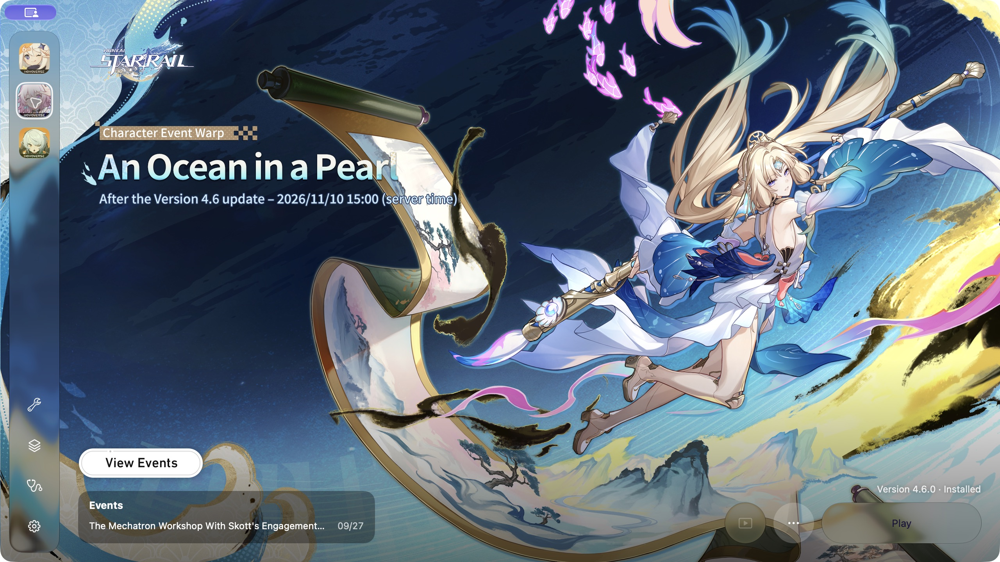
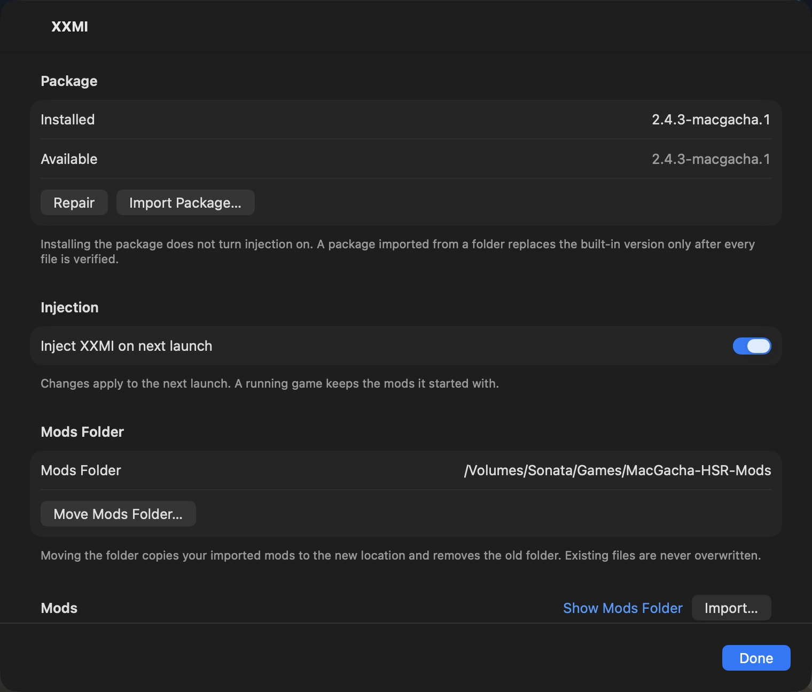
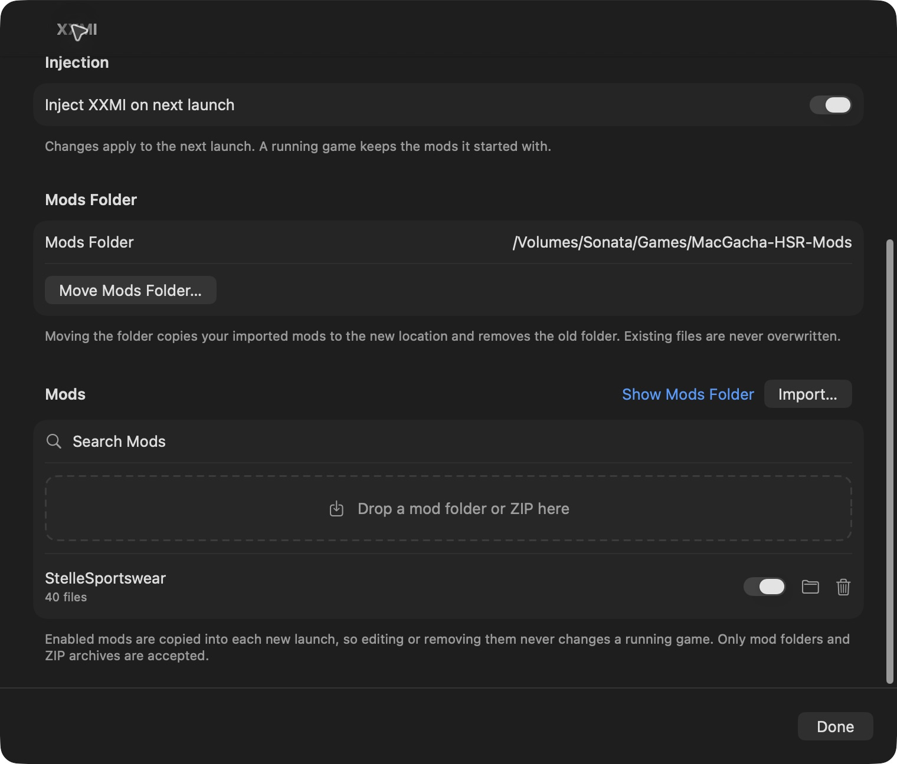
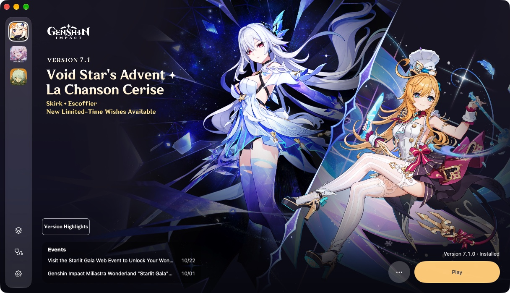

# MacGacha — universal launcher for HoYoverse games on Apple Silicon

> 🧪 **XXMI fork.** HSR mod support builds on MacGacha 0.1.3. Fork release binaries are published separately from upstream. See [fork releases](https://github.com/notsonata/MacGacha-xxmi/releases). The current regular release is [v0.1.3-xxmi.3](https://github.com/notsonata/MacGacha-xxmi/releases/tag/v0.1.3-xxmi.3).

A native macOS launcher for **Genshin Impact**, **Honkai: Star Rail** and **Zenless Zone Zero** on Apple Silicon. It aims to provide reliable resumable downloads, file verification, and managed Wine / DXMT / D3DMetal runtimes.

- Requirements: Apple Silicon Mac with Rosetta 2 (MacGacha offers to install it), macOS 27 or later.

Code and documentation in this repository may be written or modified with assistance from large language models (LLMs) and AI agents. The software is provided under the [GPL-3.0 license](LICENSE), as is, without warranty.

## XXMI mod support

Use SRMI mods in **Honkai: Star Rail Global** directly from MacGacha. Open the **wrench** in the sidebar to install XXMI and manage your mods.

### Getting started

1. Select the `d3dmetal-wine11.20-gptk4.0b3` runtime for Star Rail.
2. Open **XXMI** and click **Install**. The required package is bundled with the app, so installation works offline.
3. Import a mod folder or ZIP, or drag it into the mod list.
4. Enable the mods you want, turn on **Mods** above **Play**, and launch the game.

Mod injection is off by default. You must acknowledge the account-ban risk before enabling it. See [Is it safe?](#is-it-safe).

### Managing mods

- **Enable or disable mods individually**, search your library, reveal folders in Finder, or remove mods from the XXMI panel.
- **Refresh** detects folders you add manually. Newly discovered folders start disabled until you enable them.
- **Move Mods Folder…** relocates your library to a `MacGacha-HSR-Mods` folder at your chosen location. Keep that drive connected when using mods.
- **Saved SRMI settings** carry over between launches after the game closes. Changes not yet saved by SRMI may be lost if the game crashes.
- Changes to enabled mods apply on the **next launch**.

### Updates

Download the latest MacGacha DMG from [Releases](https://github.com/notsonata/MacGacha-xxmi/releases) and replace the app. Open **XXMI → Update** to install the bundled compatibility update while keeping your mods and settings. Use **Repair** to reinstall the current package, or **Import Package…** to install a separately downloaded XXMI package. Automatic app updates are currently unavailable.

### Included components

| Component | Version |
|---|---|
| MacGacha | 0.1.3, build 3 |
| XXMI Libraries | 1.2.2 |
| SRMI | 2.4.3 |
| HSR compatibility package | 2.4.3-macgacha.2 |

MacGacha uses the standalone XXMI injector core and a launch runner. You do not need XXMI Launcher. Mod injection currently supports **Star Rail Global with D3DMetal Wine 11.20 / GPTK 4.0b3**. Genshin Impact, Zenless Zone Zero and Mainland China editions do not yet support XXMI injection.

For source updates and package maintenance, see [the XXMI build guide](compat/xxmi/README.md).

## Downloads

The [current regular release](https://github.com/notsonata/MacGacha-xxmi/releases/tag/v0.1.3-xxmi.3) has two uploaded downloads:

| Download | Purpose |
|---|---|
| [MacGacha-0.1.3-xxmi.3.dmg](https://github.com/notsonata/MacGacha-xxmi/releases/download/v0.1.3-xxmi.3/MacGacha-0.1.3-xxmi.3.dmg) | App installer, with the verified XXMI package already bundled. |
| [XXMI-HSR-2.4.3-macgacha.2.zip](https://github.com/notsonata/MacGacha-xxmi/releases/download/v0.1.3-xxmi.3/XXMI-HSR-2.4.3-macgacha.2.zip) | Complete standalone package for independent installation. Extract it and select its `XXMI-HSR-2.4.3-macgacha.2` folder using **XXMI → Import Package…**. |

The standalone package contains `manifest.json`, `hsr-srmi.zip`, instructions and notices. It is different from a mod ZIP, which belongs in the panel's mod importer. [Corresponding XXMI source, raw package files and checksums](https://github.com/notsonata/MacGacha-xxmi/releases/tag/xxmi-2.4.3-macgacha.2) are kept on a separate compatibility release.

## Install

1. Download `MacGacha-<version>.dmg` from [fork releases](https://github.com/notsonata/MacGacha-xxmi/releases), open it and drag **MacGacha** to **Applications**.
2. Open MacGacha. MacGacha isn't signed or notarized by Apple, so macOS says it can't verify the developer. Click **Done**.
3. Open **System Settings → Privacy & Security**, scroll down to the MacGacha message and click **Open Anyway**, then confirm.

If there's no **Open Anyway** button, or macOS still refuses to open the app, remove the download quarantine flag in Terminal and open MacGacha again:

```bash
xattr -dr com.apple.quarantine /Applications/MacGacha.app
```

This only changes MacGacha itself, not any system setting. The first launch can take a while as macOS checks the app.

## Screenshots



| XXMI setup and injection | Mod library and folder location |
|---|---|
|  |  |

### Other launcher features



| Install | Downloading |
|---|---|
|  |  |

| One-click setup | Runtimes |
|---|---|
|  |  |


## Roadmap

**Done**
- **HSR XXMI integration.** Offline verified setup, opt-in injection, a **Mods** switch above **Play**, per-mod switches, folder/ZIP import, library refresh for Finder-added folders, search, Finder actions and a movable library. Enabled mods are copied into each new launch snapshot, and SRMI user settings carry over between launches.
- **Display choice.** Each game can open on a chosen monitor, with the main display as the default and fallback.
- **Progress timing.** An estimated time remaining for downloads and full verification, elapsed time for phases without a percentage, and a signal when progress is taking longer than usual.
- **Automatic updates** (Sparkle, upstream). Upstream MacGacha has **Check for Updates…** in the app menu and a switch in Settings, and it asks before downloading or installing. In this fork the feed is fork-specific and disabled until the fork owner provisions signing keys, so **Check for Updates…** and the switch stay inactive. Update manually from [this fork's releases](https://github.com/notsonata/MacGacha-xxmi/releases) meanwhile, and Settings links to them.
- **Download engine.** Resumable, verified downloads with a crash-safe journal. A file reaches the game folder only after its hash matches. Files are downloaded and assembled in parallel, close to the full speed of a 2.5 Gbit link.
- **Installing games** through HoYoverse's official delivery: install, update, verify and repair, voice packs, using an existing installation, and uninstall. Pause and resume work across app restarts. Free space is checked before and during the download. If macOS is still holding space (Time Machine snapshots, caches), the launcher says so instead of just "not enough space".
- **Runtimes.** Wine, DXMT and D3DMetal are downloaded and kept side by side, so an update never breaks a working version. D3DMetal is installed only after you accept Apple's terms, or imported from an existing Game Porting Toolkit. The default DXMT build now uses CrossOver's Wine, which needs about 2.5× less CPU than the previous one.
- **Compatibility components.** jadeite and a Steam launcher shim are installed and removed from the Runtimes window. We build the shim ourselves, reproducibly, from Valve's Proton source ([release](https://github.com/deruta74/MacGacha/releases/tag/steam-shim-proton-10.0-4)).
- **Launcher.** One window for all three games with the official banners and background art, plus a diagnostics bundle for bug reports. Backgrounds keep HoYoPlay’s order and remember the selection for each game. A new app session starts at the next background, and dots at the top let you choose one. Stills crossfade over 800 ms. Each background's Version Highlights button and the current events from HoYoPlay, listed below it, open in the browser. Animated backgrounds play with MacGacha's own video player, which uses about a third less memory than the previous web view.
- **One-click Play.** Press Play, and the launcher prepares the Wine prefix and the compatibility workaround, starts the game and minimizes itself to the Dock. When the game closes, it comes back and puts back any game files it hid. Accepted in all three games on D3DMetal and DXMT.
- **One-click setup.** When a game needs runtimes, "Set Up…" lists exactly what it needs for its settings (the Wine bundle and its compatibility component) and installs it all in one go, asking for Apple's terms only when D3DMetal is part of it. The Runtimes panel stays available for picking versions by hand.
- **Per-game settings:** graphics backend, frame limit (Off, 30, 60, 90 or 120), Retina mode, DirectX 12 for Zenless Zone Zero, a switch for the compatibility workaround, and Unlock 120 FPS for Honkai: Star Rail, which sets the game's own saved frame rate before each launch.
- **Recovery.** If the launcher crashes or is quit while a game runs, it finds the game again on restart and restores everything once the game exits. Quitting during a game asks first.
- **Privacy.** Games use separate Wine prefixes with isolated shell-folder links. This is not a security sandbox: the managed injection path requires Wine's Z: mapping to the host filesystem. Session logs stay on your Mac and can be turned off in Settings.
- **Languages.** The interface comes in English, Simplified and Traditional Chinese, Japanese, Korean, Russian, Ukrainian, German, French, Spanish, Portuguese, Indonesian, Thai and Vietnamese. It follows your Mac's language order, or you pick one in Settings. Game news and art follow the interface language (English for Ukrainian, which HoYoPlay doesn't offer). Changing the language restarts MacGacha, and a running download pauses and picks up again by itself.

**Upstream gameplay measurements (macOS 27.0.1)**

These inherited upstream measurements describe ordinary game launching, not XXMI acceptance for all games. All three games start and play with a community anti-cheat workaround. None of them needs `/etc/hosts` changes or administrator rights. Measured on a MacBook Pro 14″ with M5 Pro (48 GB) and on a base M5 (16 GB). Zenless Zone Zero used the same graphics preset on both.

| Game | Default backend | M5 Pro, 48 GB | M5, 16 GB |
|---|---|---|---|
| Honkai: Star Rail 4.6 | D3DMetal, 60 fps cap | 60 fps on Ultra. About half the CPU of DXMT, GPU time about 6.5 ms against 9 ms. | Not measured yet. |
| Zenless Zone Zero | D3DMetal, DirectX 12 | 120 fps on High, battle dips stay above 115. With ray tracing on Low, 70–90 fps. | 70–110 fps on High in battle, depending on how many enemies and effects are on screen. With ray tracing on Low, 50–60 fps. |
| Genshin Impact 7.1 | D3DMetal, 60 fps cap | Steady 60 fps on Ultra at 1800×1169 with render scale 1.2, even frame time. | 60 fps at 1512×982 with render scale 1.2. |

DXMT works for every game and stays available as the open-source alternative. The 60 fps cap fixes uneven frame pacing in Star Rail and Genshin, and it can be changed per game.

**In progress**
- **Mainland China editions (beta).** A region switch in Settings shows 原神, 崩坏：星穹铁道 and 绝区零 with their own installs, prefixes and settings. 绝区零 installs from the miHoYo servers and runs past the login screen with our [Wine crypt32 fix](https://github.com/deruta74/MacGacha/releases/tag/crypt32-fix-wine-11.20-1). 原神 and 崩坏：星穹铁道 still need in-game testing, and login hasn't been tested on any mainland edition. Testers with mainland accounts are welcome.
- **Star Rail's in-game hotfix restart**, which hasn't been tested yet.

**Next**
1. **Wine 11.21 runtime**, which has the crypt32 fix built in. Our separate fix then goes away.
2. **FPS unlocker (opt-in)** for games capped at 60 fps, off by default, with a ban-risk warning before you enable it.
3. **Pre-download.** Downloading the next version before release.
4. **Audio.** Surround output, including Spatial Audio on AirPods.

## Feedback

Found a bug or have an idea? [Open an issue in this fork](https://github.com/notsonata/MacGacha-xxmi/issues) and say what you did and what happened, with your Mac model, macOS version, the game and its graphics backend. For problems with installing or launching, attach a diagnostics bundle: **Diagnostics** in the sidebar → **Export Diagnostic Bundle…**. It removes paths and tokens. For XXMI problems, say which mod you used and whether injection was already enabled before launch. Do not attach mod files themselves.

## Is it safe?

Use at your own risk. Running these games under Wine already needs community anti-cheat workarounds (jadeite, a Steam launcher shim). Those workarounds may conflict with HoYoverse's Terms of Service, and an account ban is possible. This project has no reliable ban-rate data and makes no claim that any setup is safe, undetectable or ban-free. If you are worried, try it first with a new free-to-play account.

Mod injection adds a separate risk on top of the Wine workarounds. It loads SRMI into the Star Rail process, which HoYoverse may treat as cheating, and that risk applies even when the Wine workaround itself works as intended. Injection is **off by default**. MacGacha asks you to acknowledge the ban risk before the first enable, and the XXMI panel shows the current setting before you launch.

Without mod injection, MacGacha downloads games only from HoYoverse's official servers and verifies every file. It does not change the game process, never edits `/etc/hosts` and never asks for your password. Each game uses its own Wine prefix with isolated shell-folder links, but Wine is not a security sandbox and host paths can remain accessible through Z:.

Other optional features that change the game process, such as an FPS unlocker, are also **off by default**. Before you turn one on, MacGacha warns you about the extra ban risk.

## Disclaimer

MacGacha is an unofficial, community project. It is not affiliated with, endorsed by, or supported by HoYoverse (COGNOSPHERE) or Apple Inc. All game names and trademarks belong to their respective owners.

- Using third-party launchers may conflict with HoYoverse's Terms of Service. Use at your own risk.
- Under Wine, the games' anti-cheat stops them from starting. To launch them, MacGacha uses community workarounds: [jadeite](https://codeberg.org/mkrsym1/jadeite) for Star Rail, which also blocks one game server through a local proxy while the game runs, and a Steam launcher shim for Genshin Impact and Zenless Zone Zero. These workarounds may conflict with the Terms of Service and could lead to an account ban. By default, MacGacha doesn't change the game process. Optional features that do, such as an FPS unlocker or XXMI mod injection, are off by default, and MacGacha warns you about the ban risk before you enable them. Mod injection is a separate risk from the Wine workarounds, and this project makes no claim about ban rates or undetectability.
- The software is provided as is. The authors aren't responsible for account bans, data loss or any other damage.
- D3DMetal and the Game Porting Toolkit are © Apple Inc. and licensed under Apple's terms. The launcher will ask you to accept those terms before it downloads the component.

## Related projects

- [DXMT](https://github.com/3Shain/dxmt): a Metal-based Direct3D 11 translation layer, one of MacGacha's two graphics backends.
- [jadeite](https://codeberg.org/mkrsym1/jadeite): the anti-cheat workaround MacGacha uses for Star Rail.
- [XXMI-Launcher](https://github.com/SpectrumQT/XXMI-Launcher), [XXMI-Libs-Package](https://github.com/SpectrumQT/XXMI-Libs-Package) and [SRMI-Package](https://github.com/SpectrumQT/SRMI-Package): the upstream projects behind this fork's mod support.

## Special thanks

- The [Wine](https://www.winehq.org) project, and CodeWeavers for CrossOver's open-source Wine.
- 3Shain for DXMT and yaagl, whose launch research MacGacha builds on.
- dbc-hbin for the Wine 11.20 + D3DMetal builds.
- mkrsym1 for jadeite.
- Valve for Proton, the source of our Steam launcher shim.
- an-anime-team, whose bug tracker traced the Mainland China crash ([AAGL #572](https://github.com/an-anime-team/an-anime-game-launcher/issues/572)), and Michael Nelson for the upstream Wine fix ([MR 11824](https://gitlab.winehq.org/wine/wine/-/merge_requests/11824)).
- Apple for D3DMetal and the Game Porting Toolkit.
- SpectrumQT for XXMI, SRMI and the underlying 3DMigoto work this fork's mod support builds on.

## License

Copyright (C) 2026 deruta74. MacGacha is free software under the [GNU General Public License v3.0](LICENSE), with one additional term under GPL section 7(b) (see [NOTICE](NOTICE)): the link to the original project, https://github.com/deruta74/MacGacha, must be kept by every conveyed (distributed) copy and every distributed work based on MacGacha, both in its source and in its About screen. Private modifications that aren't distributed aren't affected. Any distributed version, modified or paid, must stay under GPL-3.0 with its source available.

Components the launcher downloads at runtime (Wine, DXMT, D3DMetal, jadeite, the Steam shim) and the games themselves are under their own licenses and terms.
