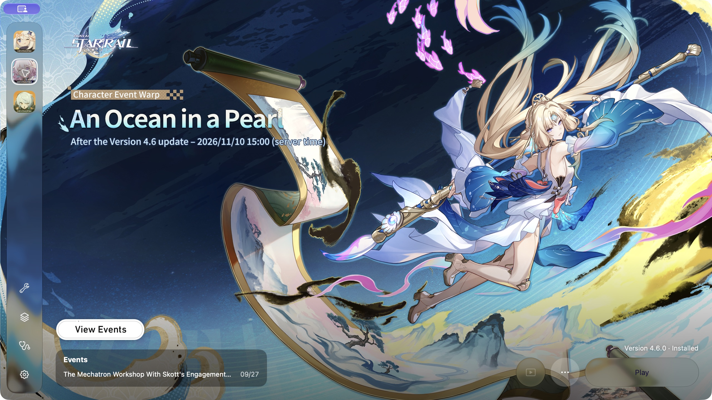
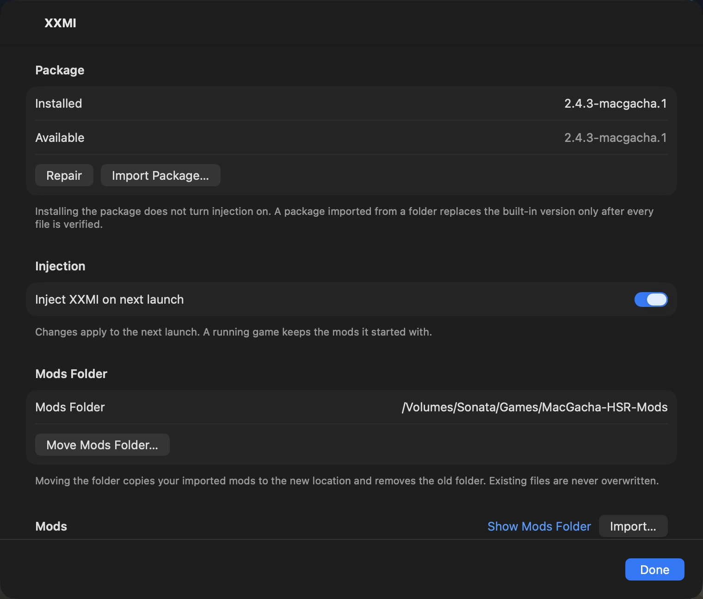
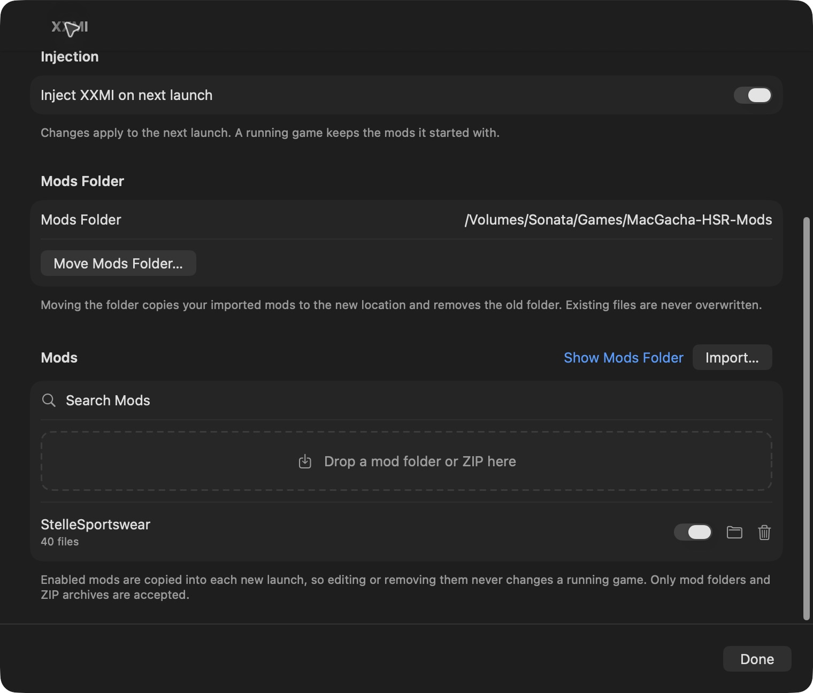

# MacGacha 0.1.3 — XXMI update 3

Regular release `v0.1.3-xxmi.3`, based on upstream MacGacha 0.1.3 (`4afb18a`).

## Versions

- MacGacha **0.1.3**, build **3**
- XXMI Libraries **1.2.2**
- SRMI **2.4.3**
- MacGacha HSR compatibility package **2.4.3-macgacha.2**
- Standalone `3dmloader.dll` injector core and MacGacha hook runner. The XXMI Launcher UI is not included.

## New

- **Mods switch above Play** on the Global Star Rail screen. It shares the XXMI panel's injection setting and first-enable risk acknowledgment.
- **Refresh** in the XXMI panel detects mod folders copied into the selected library in Finder. Newly discovered or renamed folders start disabled until you enable them.
- **Saved SRMI settings** carry over between launch snapshots after the game ends. A failed save-back remains retryable through launch recovery.

## Fixes

- **Core cursor coordinates:** valid zero client coordinates no longer fall back to desktop coordinates. Client and normalized cursor values now check API results and handle small windows, minimized windows and failed conversions consistently.
- **Core conditional parsing:** an invalid or empty `if`, `elif` or `else if` keeps its block boundaries and runs neither branch. Previously a failed condition could leave its body unguarded or disturb surrounding branches. This correction applies to the runtime, without rewriting individual mods.
- **Mod discovery:** rejected scans retain existing identity and enabled state. A malformed folder name cannot block safe siblings, and refresh cannot silently re-enable a renamed, disabled mod.
- **Finder and feedback:** Reveal uses the actual folder for manually added mods. Failed changes from the main-screen Mods switch show an error.

## Changes

- Compatibility package `.2` includes patches 0009 and 0010 in a pinned stage-3 build. All 34 first-party translation units are rebuilt, with no stage-2 first-party object reuse. The 76 reused third-party objects remain hash-verified.
- The standard source rebuild reproduces the combined DLL byte-for-byte. Corresponding-source packaging includes the final patched source and build plan.
- Regression fixtures exercise the relevant production code offline, including valid and invalid conditions, nested branches, cursor failures and query recovery.
- Earlier callback cleanup, NGX backend-context forwarding and numeric TextPrinter shader corrections remain included.

## Validation and limits

- Host regression tests, app/package tests, Release build and synthetic D3DMetal graphics checks passed. Synthetic graphics checks cover device creation, both resize-interface routes, pixel readback and Presents.
- These checks do not establish that the reported Evernight slider behavior or Castorice visual conflicts are fixed in live HSR. Please test your mods after updating.
- Mods copied from another PC manager may reference generated namespaces that were not copied with them. The parser now disables invalid conditional blocks rather than executing their commands unguarded. It does not recreate missing dependencies or strip manager guards. Use clean original mod INIs or supply the matching dependencies.
- Supported injection remains **Honkai: Star Rail Global** on **d3dmetal-wine11.20-gptk4.0b3**. Other games keep their normal launch path. Enabled HSR injection on an unsupported runtime blocks launch until disabled or corrected.
- Injection is off by default for new users and can carry account-ban risk. No account-safety or undetectability claim is made.
- The app is ad-hoc signed, not Apple Developer ID signed or notarized. Automatic app updates remain disabled pending fork-owned update signing.

## Downloads and installation

This app release has exactly two uploaded assets:

- **MacGacha-0.1.3-xxmi.3.dmg** — drag MacGacha into Applications to update it.
- **XXMI-HSR-2.4.3-macgacha.2.zip** — complete standalone compatibility package. Extract it and select the folder containing `manifest.json` and `hsr-srmi.zip` in **XXMI → Import Package…**.

Existing users should open **XXMI → Update** after replacing the app to activate the new bundled package. User mods, enabled states and the selected library location are preserved.

[Corresponding XXMI source and checksums](https://github.com/notsonata/MacGacha-xxmi/releases/tag/xxmi-2.4.3-macgacha.2) are on the separate compatibility release. GitHub also adds its automatic app-source links.

Requirements: Apple Silicon, macOS 27 or later, and Rosetta 2 when requested. If macOS blocks this unnotarized build, use its normal **Privacy & Security → Open Anyway** flow.

## App screenshots

These screenshots are from the previously installed XXMI app and show the existing launcher and panel. This update adds the main-screen Mods switch and Refresh action described above.

